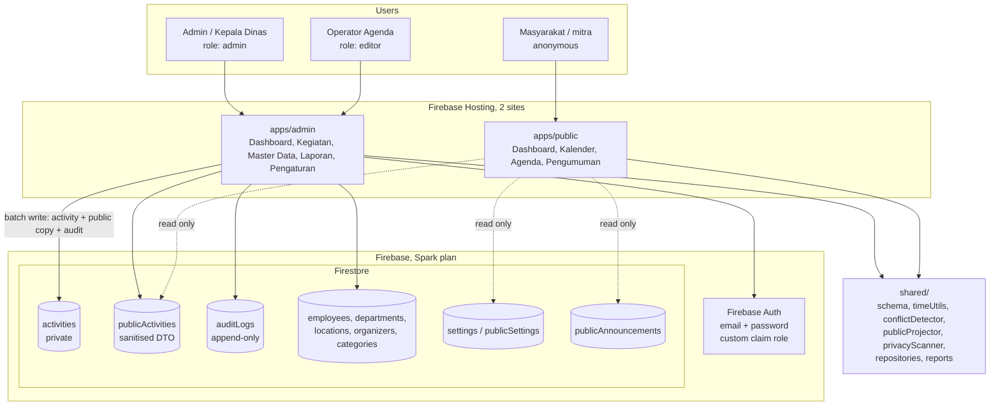
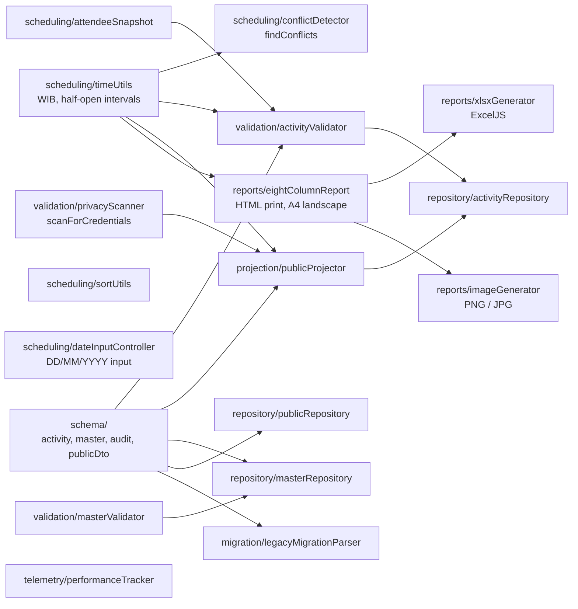
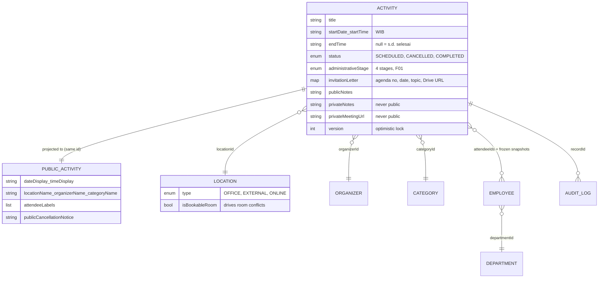
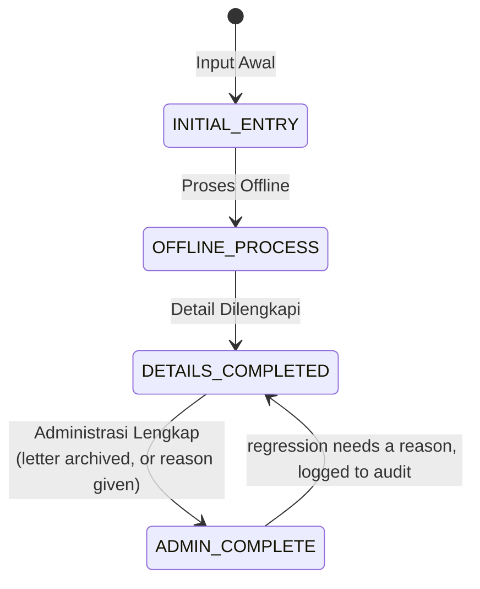
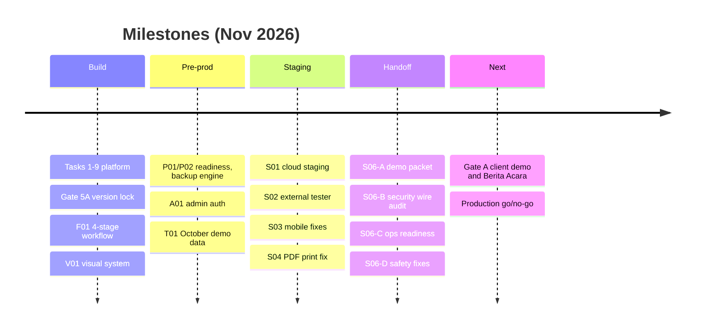

# SIMAK DISKUM v5.0: codebase map

Source: `github.com/throwawaybtm/simak-diskum-v5`, commit `37f237c` (read 2026-11-23).
Client: Dinas Koperasi dan Usaha Mikro Kota Batam. Product: *Sistem Informasi Manajemen Agenda Kedinasan*, a scheduling and publication system for the department's official agenda.

Unlike the other projects in this repo, this one is **already built** and sits on cloud staging. The research here describes what exists, so the PRD, guidebook and dev handbook can be written to match it.

## 1. What is in the repo

| Path | What it is | Status |
|---|---|---|
| `department-agenda-firebase/` | **v5.0, the current app.** npm workspaces monorepo: `apps/public`, `apps/admin`, `shared`. Vite 6 + TypeScript 5.7, vanilla (no framework), Firebase Auth + Firestore + multi-site Hosting. About 16.5k lines of TS/CSS. | Live on staging, production not yet deployed |
| `department-agenda/` | v4.0, the earlier version: two Google Apps Script web apps (public, admin) over one Google Sheet. | Superseded |
| `department-agenda-firebase/docs/` | About 35 engineering docs, one per milestone (specs, QA reports, runbooks, handoff packets). Mostly English, some Indonesian. | Current |
| `docs/` (repo root) | An older copy of the same docs, plus two unrelated plans (ESP32 servo). | Stale duplicate |
| `templates/` | Master-data templates, including a provisional 70-person staff roster. | See §8 |

## 2. System architecture

There is **no server-side code**. All writes go from the admin browser straight to Firestore and are policed by `firebase/firestore.rules`. The admin app writes `activities/{id}`, `publicActivities/{id}` and an `auditLogs` entry in one batch (`shared/src/repository/activityRepository.ts:71`), so the public copy is produced on the client by `projectPublicActivity()`.

## 3. Module graph (`shared/`)

Both apps import only the `@department-agenda/shared` barrel (31 imports) plus the Firebase SDK. Largest files: `apps/admin/src/main.ts` (1,105 lines: router and auth state machine), `MasterDataPage.ts` (909), `ReportsPage.ts` (719), `eightColumnReport.ts` (661).

## 4. Data model

Firestore rules (`firebase/firestore.rules`): public can read only `publicActivities`, `publicAnnouncements`, `publicSettings`. `admin` and `editor` (custom claims) can write activities; only `admin` can delete activities or change master data and settings. Every update must set `version = old + 1`. Audit logs are append-only and must carry `actorId == auth.uid` and `timestamp == request.time`. Separate rule sets exist for the emulator and for maintenance mode.

## 5. Features, as built

| # | Feature | Where | Source doc |
|---|---|---|---|
| 1 | Public dashboard: today's agenda (WIB), 4 metric cards, announcements | `apps/public/src/pages/DashboardView.ts` | `VISUAL_DESIGN_SYSTEM.md` |
| 2 | Public calendar: month, week, day, list | `CalendarView.ts` | S03, V01 |
| 3 | Public search and filters (date range, category, organizer, status) | `AgendaView.ts` | |
| 4 | Activity detail modal, cancelled-activity notice | `ActivityDetailModal.ts` | |
| 5 | Admin login, password recovery, access-denied state, roles admin/editor | `auth/authService.ts`, `AuthPages.ts` | `A01_ADMIN_AUTH_IMPLEMENTATION.md`, `gate5_auth_specification.md` |
| 6 | Admin dashboard: stage counts, donut chart, pending items | `DashboardPage.ts` | |
| 7 | Activity CRUD, duplicate, cancel with reason, live public preview | `ActivitiesPage.ts`, `ActivityEditPage.ts` | |
| 8 | 4-stage administrative workflow plus invitation-letter panel (F01) | `ActivityEditWorkflow.ts` | `FEATURE_F01_SPEC.md` |
| 9 | Conflict detection for bookable rooms and personnel (warn, then confirm or cancel) | `conflictDetector.ts`, `ConflictWarningModal.ts` | |
| 10 | Privacy scanner: blocks meeting links/PINs in public notes | `privacyScanner.ts` | |
| 11 | Optimistic concurrency with a version-conflict dialog | `VersionConflictDialog.ts` | Gate 5A |
| 12 | Master data: 5 tabs (Pegawai, Unit/Bidang, Ruangan, Penyelenggara, Kategori), soft deactivation, referential safeguards | `MasterDataPage.ts` | |
| 13 | Official 8-column report: A4 landscape print/PDF, `.xlsx`, PNG/JPG | `ReportsPage.ts`, `reports/*` | `S04_PDF_PRINT_REMEDIATION.md` |
| 14 | Settings: signatory (read-only for now) | `SettingsPage.ts` | Gate A §3 |
| 15 | Audit log on every write | `activityRepository.ts` | |
| 16 | Ops CLIs: role management, backup/restore, preflight checks, staging seed, legacy-spreadsheet import | `scripts/*.mjs` | `BACKUP_RECOVERY_RUNBOOK.md`, `DEPLOYMENT_RUNBOOK.md`, `T01_*` |

The 8 report columns are fixed: `No | Hari / Tanggal | Pukul | Kegiatan | Tempat | Penyelenggara | Dihadiri Oleh | Keterangan`.

### F01 administrative stages

The stage is separate from the operational `status` (Terjadwal / Dibatalkan / Selesai).

## 6. Where the project is

Status per `docs/TASK_PROGRESS.md` (2026-11-09): **"Gate A handoff ready, awaiting actual stakeholder demonstration and acceptance."** 255 unit tests across 27 files. Production project `simakdiskum` untouched. The README still says S05 (external QA) is next; TASK_PROGRESS has moved past it to S06.

Open items before production (`GATE_A_CLIENT_ACCEPTANCE_HANDOFF.md`):
- Form A: official signatory (name, NIP, title, SK number).
- Form B: Subbag Kepegawaian verifies the 70-person roster.
- Form C: production admin account nominee.
- Signed Berita Acara, then the project owner's written GO.
- Post-launch backlog: letterhead (kop surat) and signature block on the PDF, editable signatory settings.

## 7. How it compares with this repo's rules (CLAUDE.md)

| Rule here | SIMAK DISKUM v5 | Gap |
|---|---|---|
| PRD in Indonesian, client-approved, before anything | No PRD. Scope lives across milestone specs; acceptance is the Gate A Berita Acara. | **Write a PRD that records the built scope** |
| Guidebook (HTML → A4 PDF, Indonesian, no pricing) | The S06-A demo packet and README play this role, in markdown. | **Write the guidebook** |
| Dev handbook opening with a stack decision record | Facts are spread across ~35 docs; no single decision record. | **Consolidate into `dev-handbook.md`** |
| Agent kit | None | Needed only if more features will be built (e.g. the kop-surat backlog) |
| Default stack React + Vite + Tailwind v4 + shadcn/ui | Vanilla TS + hand-written CSS tokens | Record as a justified deviation; don't rewrite |
| GAS as server layer, every endpoint checks Firebase identity | No server layer; Firestore rules only | Fine for Spark; the decision record should say so |
| Free first (Spark) | Spark, $0/month | Matches |
| WCAG **2.2** AA | Docs claim WCAG **2.1** AA | Run `check:a11y` against staging; check 2.2 additions (target size, focus not obscured) |
| Never serve Drive files as public links | Stores a Drive URL on the invitation letter, internal by default | Confirm the URL never reaches `publicActivities` |
| Human checkpoint 3: personal data | Roster with NIPs is in the repo (see §8) | **Needs a decision now** |

## 8. Risks found while reading

1. **Repository visibility.** The README and Gate A packet say the repo is private ("private (404)"), but it is publicly readable: this session cloned it anonymously. It contains `templates/temporaryEmployeeMaster.json` (70 staff, with NIPs), a default signatory with name and NIP in `shared/src/schema/master.ts`, and an external tester's personal email in `docs/S02_EXTERNAL_QA_TESTER_PROVISIONING.md`. None of that is copied into this repo.
2. **Duplicate docs.** `docs/` at the root has drifted from `department-agenda-firebase/docs/` and holds unrelated ESP32 plans.
3. **Machine-specific links.** Some docs link to `file:///d:/Temp/...`.
4. **Status drift.** README badge says S04; the ledger says S06-D.
